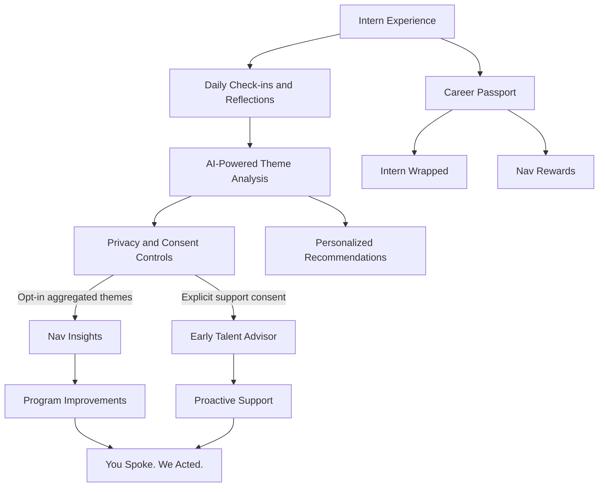

# 🧭 RBC Nav

### Your journey. Your voice. Your future.

**Empowering early talent. Capturing authentic experiences. Driving meaningful change.**

RBC Nav is a privacy-first digital career companion designed to enhance the early talent experience while enabling RBC to identify disengagement, uncover systemic challenges and proactively support its next generation of talent.

## 🎯 The Challenge

How can RBC better capture the voices of early talent participants, identify students at risk of leaving, uncover opportunities for program improvement and enable proactive intervention?

Traditional feedback mechanisms may capture concerns too late. Interns may also hesitate to communicate challenges due to uncertainty, fear of judgment or lack of accessible support.

RBC Nav reimagines feedback as a continuous, rewarding and personalized experience.

## 💡 Our Solution

Rather than introducing another employee survey, RBC Nav creates an everyday career companion that gives interns a reason to engage.

Our solution is built around four pillars:

- **Listen:** Capture authentic, continuous feedback.
- **Understand:** Transform experiences into meaningful insights.
- **Act:** Enable proactive support and systemic improvements.
- **Celebrate:** Recognize professional achievements and personal growth.

## ✨ Key Features

### ☀️ Daily Nav

A personalized dashboard designed to launch when interns begin their workday.

- Daily mood check-ins and goal setting.
- Personalized schedules and reminders.
- Learning and networking opportunities.
- Countdown to the next Intern Wrapped.

### 🌙 Daily Reflection

An optional end-of-day reflection, designed to take approximately 30 seconds.

- Daily experience and satisfaction check-ins.
- Feedback on mentorship, onboarding, team dynamics, belonging and career development.
- Personal accomplishments and challenges.
- AI-powered theme identification and support recommendations.
- Consent-based feedback sharing.

### 🤖 Ask Nav

An AI-powered career companion designed to help interns navigate their professional journey.

- Workplace guidance.
- Personalized career recommendations.
- Learning resources.
- Preparation for professional conversations.
- Confidential support recommendations.

### ☕ Coffee Connect

A networking and mentorship experience that encourages meaningful professional relationships.

- Personalized mentor recommendations.
- Coffee chat opportunities.
- Cross-team networking.
- Professional connection tracking.

### 📘 Career Passport

A centralized record of an intern's professional development.

- Skills developed.
- Projects and accomplishments.
- Learning milestones.
- Professional connections.
- Recognition and achievements.
- Exportable, approved professional highlights for future career opportunities.

### 🎉 Intern Wrapped

Inspired by Spotify Wrapped, Intern Wrapped transforms professional development into an engaging, personalized experience.

**Biweekly Wrapped**

Every two weeks, interns receive a personalized recap highlighting:

- New skills.
- Professional connections.
- Accomplishments.
- Recognition points.
- Personal growth.
- Recommended goals.

**Final Intern Wrapped**

A comprehensive, end-of-internship celebration summarizing the participant's entire professional journey.

**Cohort Wrapped**

An aggregated overview of collective achievements, experiences and opportunities for program improvement.

### 🏆 Nav Rewards

A proposed integration with RBC's existing employee recognition ecosystem.

Interns can celebrate eligible achievements through:

- Recognition points.
- Learning milestones.
- Peer appreciation.
- Achievement badges.
- Rewards and merchandise, subject to existing program eligibility.

Recognition is designed to reward meaningful contributions, never the disclosure of personal information or the submission of positive feedback.

### 💳 NFC Nav Card

A physical companion to the digital experience.

- Tap to access Nav.
- Tap to connect with colleagues.
- Tap to access professional achievements.
- Tap to unwrap personalized internship highlights.

Future implementation could explore integration with existing RBC employee work passes, subject to security approval.

### 📊 Nav Insights

An aggregated analytics dashboard designed for early talent program leaders.

- Engagement and experience trends.
- Mentorship effectiveness.
- Onboarding satisfaction.
- Team dynamics and belonging.
- Career development insights.
- Early support indicators.
- Recommended program improvements.
- Consent-based advisor intervention requests.

### 🔄 You Spoke. We Acted.

A transparent feedback loop that demonstrates how intern experiences influence meaningful organizational improvements.

Interns can see how collectively shared feedback contributes to changes within their programs.

## 🔐 Privacy by Design

Trust is fundamental to capturing authentic feedback.

RBC Nav proposes three levels of data visibility:

| Level | Description |
|---|---|
| Private | Personal reflections and individual career insights remain private by default. |
| Aggregated | Interns voluntarily contribute anonymized themes to program-level insights. |
| Personalized Support | Interns explicitly authorize designated advisors to provide individual support. |

Proposed production safeguards include:

- Role-based access controls.
- Data encryption.
- Data minimization.
- Responsible AI and human oversight.
- Consent management.
- Aggregation thresholds.
- Corporate authentication.
- No employee surveillance.
- No individual risk scores used in employment decisions.

## ⚙️ Conceptual Architecture

## 🏦 Built for RBC. Built on RBC.

Rather than replacing existing infrastructure, RBC Nav proposes leveraging RBC's existing ecosystem:

- RBC Academies.
- Employee Voice.
- Employee recognition programs.
- Make A Difference Awards.
- Instant Thanks.
- Microsoft Teams and Outlook.
- Existing employee work passes.
- Corporate authentication systems.

All integrations are conceptual and subject to organizational approval, technical feasibility and security requirements.

## 📈 Potential Business Impact

RBC Nav aims to deliver value for both interns and the organization.

| For Early Talent | For RBC |
|---|---|
| Increased sense of belonging | Earlier identification of disengagement |
| Personalized career development | Actionable program insights |
| Improved mentorship opportunities | Stronger talent retention |
| Recognition and motivation | More informed decision-making |
| Accessible and confidential support | Proactive intervention |
| Greater visibility into professional growth | Continuous program improvement |

### One Minute. Meaningful Impact.

Designed around an approximately one-minute daily experience, RBC Nav aims to minimize disruption while maximizing long-term value.

For an illustrative cohort of 250 interns over 16 weeks:

- **333 hours:** Estimated time invested in daily check-ins.
- **1,000 hours:** Potential time recovered through improved resource discovery and professional documentation.
- **667 hours:** Potential net productivity savings.

These figures are hypothetical and assume 15 minutes saved per intern per week. Actual impact would require pilot testing.

## 🚀 Future Roadmap

- Integration with RBC's internal platforms.
- Enterprise-approved AI infrastructure.
- Personalized mentorship matching.
- Advanced aggregated retention analytics.
- Automated desktop and Teams notifications.
- NFC-enabled employee work pass integration.
- Expansion across early talent and employee development programs.

## 🌟 Our Vision

Start with purpose.

End with reflection.

Celebrate every two weeks.

Grow throughout the journey.

**The intern grows. RBC listens. RBC acts. The experience improves.**

---

### 🧭 RBC Nav — Retaining talent starts with listening to it.
