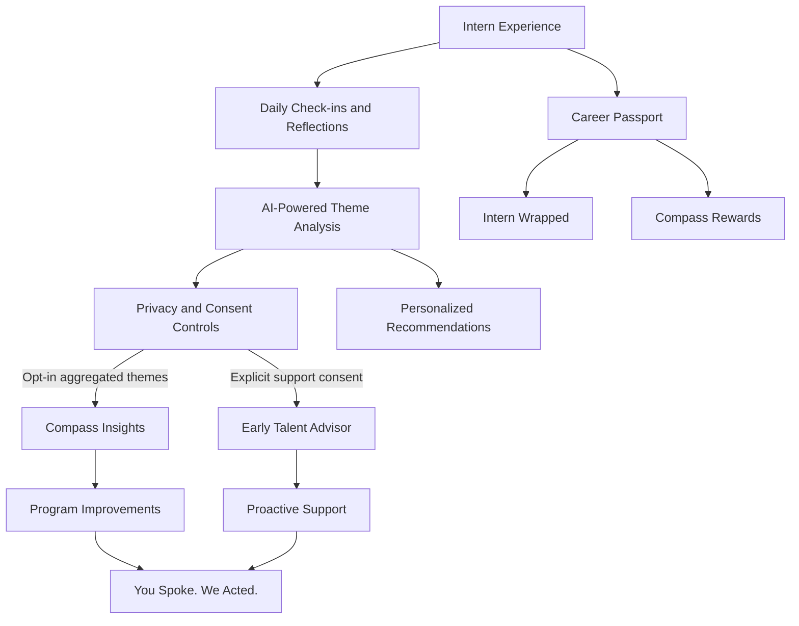

# 🧭 RBC Compass

### Your journey. Your voice. Your future.

**Empowering early talent. Capturing authentic experiences. Driving meaningful change.**

RBC Compass is a privacy-first digital career companion designed to enhance the early talent experience while enabling RBC to identify disengagement, uncover systemic challenges and proactively support its next generation of talent.

## 🎯 The Challenge

How can RBC better capture the voices of early talent participants, identify students at risk of leaving, uncover opportunities for program improvement and enable proactive intervention?

Traditional feedback mechanisms may capture concerns too late. Interns may also hesitate to communicate challenges due to uncertainty, fear of judgment or lack of accessible support.

RBC Compass reimagines feedback as a continuous, rewarding and personalized experience.

## 💡 Our Solution

Rather than introducing another employee survey, RBC Compass creates an everyday career companion that gives interns a reason to engage.

Our solution is built around four pillars:

- **Listen:** Capture authentic, continuous feedback.
- **Understand:** Transform experiences into meaningful insights.
- **Act:** Enable proactive support and systemic improvements.
- **Celebrate:** Recognize professional achievements and personal growth.

## ✨ Key Features

### ☀️ Daily Compass

A personalized dashboard designed to launch when interns begin their workday.

- Daily mood check-ins and goal setting.
- Personalized schedules and reminders.
- Learning and networking opportunities.
- Countdown to the next Intern Wrapped.

### 🌙 Daily Reflection

An optional end-of-day reflection, designed to take approximately 30 seconds.

- Daily experience and satisfaction check-ins.
- Feedback on mentorship, onboarding, team dynamics, belonging and career development.
- Personal accomplishments and challenges.
- AI-powered theme identification and support recommendations.
- Consent-based feedback sharing.

### 🤖 Ask Compass

An AI-powered career companion designed to help interns navigate their professional journey.

- Workplace guidance.
- Personalized career recommendations.
- Learning resources.
- Preparation for professional conversations.
- Confidential support recommendations.

### ☕ Coffee Connect

A networking and mentorship experience that encourages meaningful professional relationships.

- Personalized mentor recommendations.
- Coffee chat opportunities.
- Cross-team networking.
- Professional connection tracking.

### 📘 Career Passport

A centralized record of an intern's professional development.

- Skills developed.
- Projects and accomplishments.
- Learning milestones.
- Professional connections.
- Recognition and achievements.
- Exportable, approved professional highlights for future career opportunities.

### 🎉 Intern Wrapped

Inspired by Spotify Wrapped, Intern Wrapped transforms professional development into an engaging, personalized experience.

**Biweekly Wrapped**

Every two weeks, interns receive a personalized recap highlighting:

- New skills.
- Professional connections.
- Accomplishments.
- Recognition points.
- Personal growth.
- Recommended goals.

**Final Intern Wrapped**

A comprehensive, end-of-internship celebration summarizing the participant's entire professional journey.

**Cohort Wrapped**

An aggregated overview of collective achievements, experiences and opportunities for program improvement.

### 🏆 Compass Rewards

A proposed integration with RBC's existing employee recognition ecosystem.

Interns can celebrate eligible achievements through:

- Recognition points.
- Learning milestones.
- Peer appreciation.
- Achievement badges.
- Rewards and merchandise, subject to existing program eligibility.

Recognition is designed to reward meaningful contributions, never the disclosure of personal information or the submission of positive feedback.

### 💳 NFC Compass Card

A physical companion to the digital experience.

- Tap to access Compass.
- Tap to connect with colleagues.
- Tap to access professional achievements.
- Tap to unwrap personalized internship highlights.

Future implementation could explore integration with existing RBC employee work passes, subject to security approval.

### 📊 Compass Insights

An aggregated analytics dashboard designed for early talent program leaders.

- Engagement and experience trends.
- Mentorship effectiveness.
- Onboarding satisfaction.
- Team dynamics and belonging.
- Career development insights.
- Early support indicators.
- Recommended program improvements.
- Consent-based advisor intervention requests.

### 🔄 You Spoke. We Acted.

A transparent feedback loop that demonstrates how intern experiences influence meaningful organizational improvements.

Interns can see how collectively shared feedback contributes to changes within their programs.

## 🔐 Privacy by Design

Trust is fundamental to capturing authentic feedback.

RBC Compass proposes three levels of data visibility:

| Level | Description |
|---|---|
| Private | Personal reflections and individual career insights remain private by default. |
| Aggregated | Interns voluntarily contribute anonymized themes to program-level insights. |
| Personalized Support | Interns explicitly authorize designated advisors to provide individual support. |

Proposed production safeguards include:

- Role-based access controls.
- Data encryption.
- Data minimization.
- Responsible AI and human oversight.
- Consent management.
- Aggregation thresholds.
- Corporate authentication.
- No employee surveillance.
- No individual risk scores used in employment decisions.

## ⚙️ Conceptual Architecture



## 🏦 Built for RBC. Built on RBC.

Rather than replacing existing infrastructure, RBC Compass proposes leveraging RBC's existing ecosystem:

- RBC Academies.
- Employee Voice.
- Employee recognition programs.
- Make A Difference Awards.
- Instant Thanks.
- Microsoft Teams and Outlook.
- Existing employee work passes.
- Corporate authentication systems.

All integrations are conceptual and subject to organizational approval, technical feasibility and security requirements.

## 📈 Potential Business Impact

RBC Compass aims to deliver value for both interns and the organization.

| For Early Talent | For RBC |
|---|---|
| Increased sense of belonging | Earlier identification of disengagement |
| Personalized career development | Actionable program insights |
| Improved mentorship opportunities | Stronger talent retention |
| Recognition and motivation | More informed decision-making |
| Accessible and confidential support | Proactive intervention |
| Greater visibility into professional growth | Continuous program improvement |

### One Minute. Meaningful Impact.

Designed around an approximately one-minute daily experience, RBC Compass aims to minimize disruption while maximizing long-term value.

For an illustrative cohort of 250 interns over 16 weeks:

- **333 hours:** Estimated time invested in daily check-ins.
- **1,000 hours:** Potential time recovered through improved resource discovery and professional documentation.
- **667 hours:** Potential net productivity savings.

These figures are hypothetical and assume 15 minutes saved per intern per week. Actual impact would require pilot testing.

## 🚀 Future Roadmap

- Integration with RBC's internal platforms.
- Enterprise-approved AI infrastructure.
- Personalized mentorship matching.
- Advanced aggregated retention analytics.
- Automated desktop and Teams notifications.
- NFC-enabled employee work pass integration.
- Expansion across early talent and employee development programs.

## 🛠️ Hackathon Prototype

RBC Compass was conceptualized as part of the RBC Women's Technical Advisory Program Hackathon.

The prototype showcases the proposed user experience, product functionality, privacy architecture and organizational impact using illustrative scenarios and synthetic data.

Production integrations, AI capabilities and enterprise security infrastructure are proposed future implementations.

## 📡 Live NFC Demo: Tap to Recognize, Tap to Unwrap

Our signature interactive demo genuinely works in real time across two phones and one presentation laptop. It uses two physical NFC cards and a shared Firebase Realtime Database. All names, points and awards are synthetic, and recognition points are simulated. It represents a proposed integration with RBC's existing recognition ecosystem.

| Device | URL | What it does |
|---|---|---|
| Laptop on projector | `https://<your-domain>/nfc/display` | Live balance, locked Wrapped, recognition notifications, cinematic Intern Wrapped |
| Leadership Compass Card: Tap to Recognize | `https://<your-domain>/nfc/manager` | Judge picks a category, writes a message, awards 250 points |
| Intern Compass Card: Tap to Unwrap | `https://<your-domain>/nfc/intern` | Maya's portal, live points, Unlock My Wrapped |

No app needs installing. Each card stores a plain HTTPS URL record, and the phone opens it natively.

### How it works

- **One shared record:** every screen subscribes to `demos/{session}` in Firebase Realtime Database. Changes reach every screen within about a second, with no refresh and no polling.
- **Atomic, idempotent awards:** each award is a single database transaction. It adds exactly 250 points, appends the recognition and sets `latestRecognition`. The transaction is keyed by a submission ID created on the phone, so double taps and network retries can never award twice. A demo cap of 40 awards stops runaway counters.
- **Unlock:** pressing Unlock increments `unlockCount`, and the display launches Wrapped whenever that number goes up. Pressing it again replays Wrapped.
- **Validated writes:** `database.rules.json` only allows reads and writes under `demos/<session-id>`. It only accepts point changes of exactly +250 (or a reset to 1,250), the five recognition categories, messages up to 280 characters and known fields. Everything else is rejected, including reads of the database root.
- **Connection handling:** each screen shows a Live / Reconnecting indicator (`.info/connected`). If Firebase is missing or rejects a request, the page shows an explicit error instead of silently faking it.
- **Session isolation:** the NFC URLs use the deployment default session (`NEXT_PUBLIC_DEMO_SESSION`, e.g. `rbc-judges`). For a rehearsal that must not touch the judges' session, add `?s=rehearsal` to all three URLs.
- **Reset:** the display's bottom-right corner has discreet controls. They appear on hover: QR fallbacks, fullscreen (or press `F`) and reset. Reset needs two clicks.

Code: `lib/live/model.ts` (pure state logic, unit tested in `tests/liveDemo.test.ts`), `lib/live/client.ts` (Firebase), `lib/live/useLiveDemo.ts`, `components/live/*`, `app/nfc/{display,manager,intern}/page.tsx`.

> **Demo only, not production authentication.** Anyone with a card URL can award points to the demo session or reset it. That is intentional for judges, and the database rules limit what they can write. The Firebase web config values are public by design, because access is enforced by the rules. Never commit a service account key. A production version would sit behind RBC SSO and write to RBC's real recognition system server-side.

### 1. Create the Firebase backend (manual, about 10 minutes)

1. Go to [console.firebase.google.com](https://console.firebase.google.com), **Add project** (Google Analytics is not needed).
2. **Build → Realtime Database → Create Database**. Pick a location close to Toronto (e.g. `us-central1`), then **Start in locked mode**.
3. Publish the rules. Choose one:
   - CLI: `firebase login`, `firebase use --add` (pick the project), then `firebase deploy --only database`.
   - Console: open **Realtime Database → Rules**, paste the contents of `database.rules.json` and press **Publish**.
4. **Project settings → General → Your apps → Web (`</>`)**. Register an app (no hosting needed) and copy `apiKey`, `projectId` and `appId`.
5. Copy the database URL shown at the top of the **Realtime Database → Data** tab. It looks like `https://<project>-default-rtdb.firebaseio.com` or `https://<project>-default-rtdb.<region>.firebasedatabase.app`.

### 2. Configure environment variables (manual)

Locally, create `.env.local`. It is git-ignored, so don't commit it.

```bash
NEXT_PUBLIC_BASE_URL=https://<your-domain>
NEXT_PUBLIC_FIREBASE_API_KEY=...
NEXT_PUBLIC_FIREBASE_DATABASE_URL=https://<project>-default-rtdb.firebaseio.com
NEXT_PUBLIC_FIREBASE_PROJECT_ID=<project-id>
NEXT_PUBLIC_FIREBASE_APP_ID=...
NEXT_PUBLIC_DEMO_SESSION=rbc-judges
```

On Vercel, add the same variables under **Project → Settings → Environment Variables** (Production). Then **redeploy**: `NEXT_PUBLIC_*` values are baked in at build time, so changing them later always needs a new deployment.

### 3. Deploy

```bash
npx vercel --prod
```

Open `https://<your-domain>/nfc/display`. The badge in the top right should say **Live** and the balance should read **1,250**.

### 4. Write the physical NFC cards (manual)

1. Install **NFC Tools** (iOS or Android).
2. **Write → Add a record → URL/URI**. Enter `https://<your-domain>/nfc/manager`, then **Write** and hold the **Leadership Compass Card** to the phone.
3. Repeat with `https://<your-domain>/nfc/intern` on the **Intern Compass Card**.
4. Test each card on an iPhone (screen unlocked, tap the top edge) and on an Android phone (NFC on, tap the back). iPhone shows a banner; tap it to open.
5. Optional, once you're certain the URLs are final: NFC Tools can **lock** a tag. This is permanent, so the card can never be rewritten.
6. QR fallbacks: on the display, hover the bottom-right corner and press the **QR** button. It shows scannable codes for both cards, built from `NEXT_PUBLIC_BASE_URL`.

### 5. Three-device rehearsal

1. Laptop: open `/nfc/display?s=rehearsal`, press `F` for fullscreen, and check the indicator says **Live**.
2. Phone A: open `/nfc/manager?s=rehearsal`, pick **Collaboration**, press **Suggest**, then **Award 250 Recognition Points**. The phone shows a celebration and the display shows the notification, gold confetti and 1,250 → 1,500.
3. Phone B: open `/nfc/intern?s=rehearsal`. It shows 1,500 points and the new recognition. Press **Unlock My Wrapped** and the display plays Wrapped, including the new achievement.
4. Reset from the display (two clicks), then rehearse with the real cards on the default session. **Reset once more right before you present.**

### Live presentation sequence

1. Laptop on `/nfc/display`, fullscreen, showing **Live**, 1,250 points and "Waiting for Compass Card activation...".
2. A judge taps the **Leadership Compass Card**, awards Maya recognition and 250 points.
3. Everyone watches the balance rise live with the notification and gold confetti.
4. Another judge taps the **Intern Compass Card** and presses **Unlock My Wrapped**.
5. The display reveals Maya's Wrapped: 16 weeks, 12 skills, 18 connections, 6 projects, 8 milestones, the live points total and the new achievements. It ends with "Your internship ends. Your journey doesn't."

Wrapped auto-advances and holds on the final slide. Arrow keys move between slides and `Esc` closes it. After closing, the locked card on the display becomes a **Replay Wrapped** button.

### Local testing without a Firebase project

The Firebase emulator runs the real database and rules on your laptop. It needs Java and the Firebase CLI (`npm i -g firebase-tools`).

```bash
npm run emulators
```

Then, in a second terminal:

```bash
NEXT_PUBLIC_FIREBASE_EMULATOR_HOST=127.0.0.1:9000 npm run dev
```

Open `/nfc/display`, `/nfc/manager` and `/nfc/intern` in separate tabs. To test with real phones on the same Wi-Fi, use the laptop's LAN IP (e.g. `192.168.1.20`) for both the emulator host and the page URL.

### Troubleshooting

| Symptom | Fix |
|---|---|
| "Firebase is not configured" | Env vars are missing from the build. Add them on Vercel and redeploy. |
| "Permission denied" | Rules not published, or the session id has uppercase letters or symbols. Re-run `firebase deploy --only database`. |
| Indicator stuck on Connecting / Reconnecting | Venue Wi-Fi may block WebSockets. Put the laptop and phones on a phone hotspot. |
| Card opens the wrong page | Rewrite the card in NFC Tools and check the URL has no typo. Use the QR fallback meanwhile. |
| Old awards showing | Reset from the display, bottom-right corner, two clicks. |

## 🌟 Our Vision

Start with purpose.

End with reflection.

Celebrate every two weeks.

Grow throughout the journey.

**The intern grows. RBC listens. RBC acts. The experience improves.**

---

### 🧭 RBC Compass — Retaining talent starts with listening to it.
